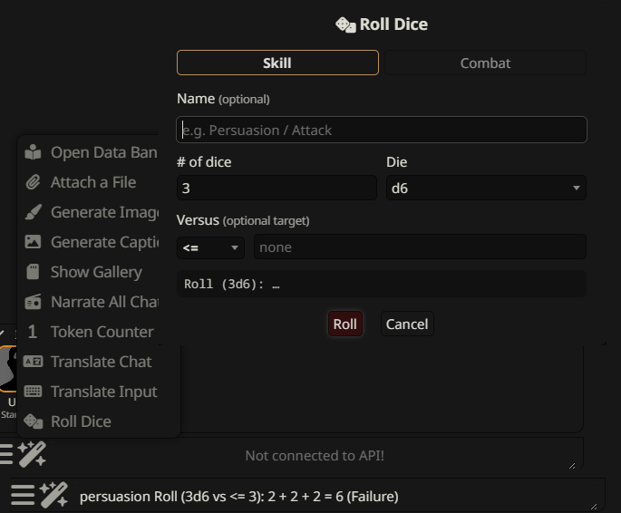
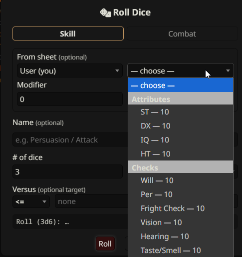
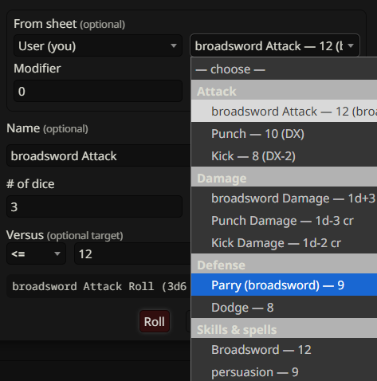

# ST-DiceRoller

A simple dice roller for [SillyTavern](https://github.com/SillyTavern/SillyTavern). The dice extension that ships with SillyTavern doesn't send results to the LLM, and macros are clunky, so this one injects the result into your message and it gets sent with it.

It's light-weight but flexible, and it holds the game system packs that sheet rolls and Combat Mode use (see Game system). You pick a target and how it's compared (roll under, like a 3d6 roll-under system, or meet-or-beat, like a d20 system), and you choose the default dice for Combat and Non-Combat rolls. Rolls against a target report the margin ("Success by 3").

The extension holds no game-system rules. Critical-success and critical-failure totals and the damage floors are settings that ship empty: fill them in from the rules of the game you play, if you want them.



## Installation

In SillyTavern: **Extensions** → **Install extension** → paste:

```
https://github.com/lalzy/ST-DiceRoller
```

Or install manually: copy this folder into `SillyTavern/data/default-user/extensions/` and reload SillyTavern.

## Usage

1. Click the **✨ wand** next to the chat input → **Roll Dice**
2. Choose **Skill** or **Combat** (this loads that preset's defaults)
3. Optionally type a name, then adjust the number of dice and the die type
4. Optionally set a **Versus** comparison and target number
5. Click **Roll** (or press Enter). The result is inserted into your message
6. Send as usual

## Settings

**Extensions → Roll Dice** has, per preset (Skill / Combat):

- Number of dice, die type and comparison.
- **Critical success totals** and **Critical failure totals**: optional lists such as `1` or `3-4, 18`. Empty by default.

And for damage rolls:

- **Minimum damage** and **Minimum injury**: optional floors. Empty means 0.

## Game system

**Extensions → Roll Dice → Game system** picks how sheet rolls work: a default for new chats, and an override for the open chat. Rolling by hand works exactly as before.

- **Classic 3d6**: 3d6, roll at or under the sheet value. Totals 3–4 are critical successes, 17–18 critical failures. The defender rolls a defense; armor reduces damage.
- **Generic d20**: 1d20 + the sheet value as a bonus, meet or beat the target number (DC 15 is filled in; change it in Versus). A natural 20 is a critical success, a natural 1 a critical failure. Attacks must reach the target's armor class; armor adds to it instead of reducing damage.

**Custom pack (JSON)**: load a pack, change what you need (dice, roll under or over, critical totals or die faces, defense model, armor, attribute names, stat modifier formula, check difficulties), give it a new `id` and save it. Missing keys come from the built-in pack it is closest to.

When you roll from a character sheet, the dice, the comparison and the criticals come from the chat's pack. Damage dice keep their own die size (1d8, 2d6…).

## For other extensions

`window.RollDice` (version 4) adds `system`:

| Call | What it does |
|---|---|
| `system.active()` | The open chat's pack (a plain object). |
| `system.list()` / `get(id)` | Built-in and custom packs. |
| `system.setChatPack(id)` / `setDefaultPack(id)` | Choose a pack ('' = the default). Fires `rolldice:pack`. |
| `system.test(pack, value, { dc, roll })` | Roll a check: `value` is the target (roll under) or bonus (roll over); `roll(sides)` can supply the dice. Returns `{ dice, total, target, success, crit, margin }`. |
| `system.describe(result)` | "4 + 3 + 2 = 9 vs 12 · success by 3" / "12 + 5 = 17 vs DC 15 · success by 2". |
| `system.chance(pack, value, dc)` | Exact chance of success. |
| `system.statMod(pack, score)` | The number rolled with for an attribute score. |

Combat Mode rolls everything through this.

## Notes
- Completely vibe-coded. 0 Human reading of the code, and not battle tested yet.

## Other extensions that work with it
- NPC Book Character Sheet (a character sheet add-on for NPC Book) registers characters as roll sources, so you can roll straight from a sheet.

Images of Roll Dice with a character sheet source enabled (for the user; the extension can be enabled without this selection):



